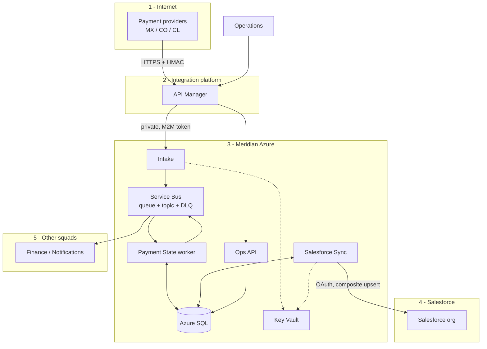
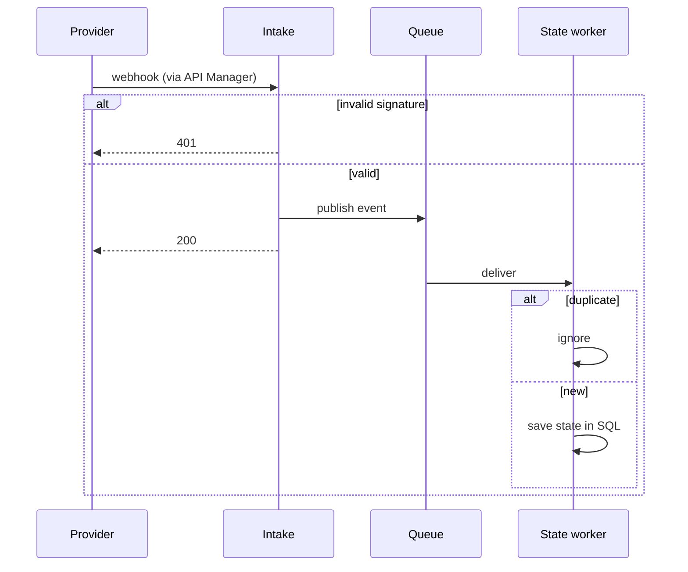
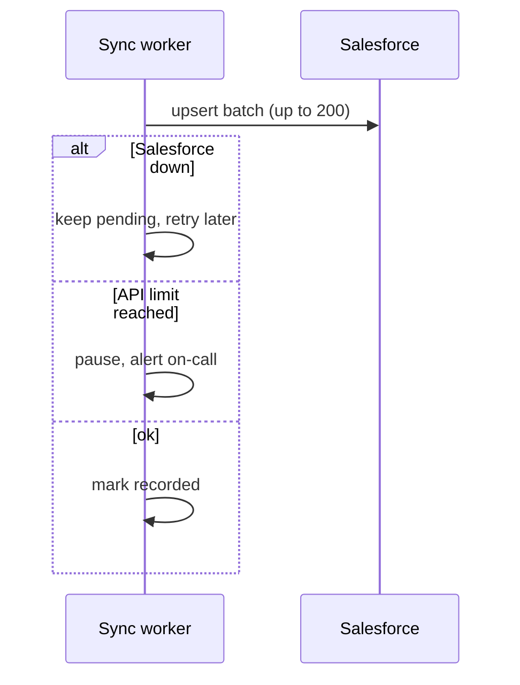

# Solution design - Premium Payment Notifications

Scope: FR1-FR7 for Mexico, Colombia and Chile. Decisions: [`docs/adr/`](../adr/). Assumptions: [`docs/ASSUMPTIONS.md`](../ASSUMPTIONS.md).

**Main idea:** we keep the latest state of each payment in our own store and send it to Salesforce from there, not from a stream of events. Duplicates, late events, Salesforce outages and the API budget are handled in one place. Salesforce never sees a stale status.

Flow: webhook -> API Manager -> **Intake** (check signature, map, publish) -> Service Bus queue -> **Payment State worker** (dedup + order in Azure SQL, publish canonical event) -> **Salesforce Sync worker** (batch upsert of the latest state).

---

## 1. Context diagram and trust boundaries

| Boundary | Control |
|---|---|
| 1 -> 2 | TLS at the API Manager. Authenticity is the **provider HMAC** (FR1). Providers cannot get an IdP token (A-04). |
| 2 -> 3 | Private Intake. API Manager uses a machine-to-machine token. Raw body is forwarded unchanged (A-03). |
| Inside 3 | Managed identities, least-privilege RBAC, private endpoints. |
| 3 -> 4 | OAuth client credentials. Secret in Key Vault. Outbound only. |
| 3 -> 5 | One topic subscription per consumer. **Listen** only on that subscription. No payer personal data in events. |
| Humans | Ops API through the API Manager. IdP role. Read-only. Queries are audited. |

Payer name, national ID and email are **dropped in the adapter**. They never reach the queue, the store, the events or the logs (NFR6).

A fourth country needs a new adapter, secret and API Manager route. The queue, store, workers and topic stay the same (NFR9).

---

## 2. Sequence - one notification

Failure paths: invalid signature, duplicate, Salesforce unavailable, API limit reached.

**2a. Receive the notification**

**2b. Send to Salesforce**

Intake answers `200` only after the queue has the message (NFR3). If the queue is down, it returns `503` and the provider retries.

---

## 3. Canonical payment event

Contract: [`docs/api/events/premium-payment.schema.json`](../api/events/premium-payment.schema.json). Version in `schemaVersion` (`MAJOR.MINOR`).

Essential fields:

| Field | Meaning |
|---|---|
| `idempotencyKey` | Identity of this business event |
| `paymentKey` | `<PROVIDER>:<transactionId>` -> Salesforce `Payment_Key__c` |
| `country` / `provider` | `MX`, `CO`, `CL` and `QUETZAL`,`ANDINA`,`AUSTRAL` |
| `status` | `PENDING` / `CAPTURED` / `FAILED` / `REFUNDED` |
| `policyNumber` | Normalized `POL-<CC>-<9 digits>`, or `null` if unresolved (A-08) |
| `amount` / `currency` | Major units, ISO 4217 |
| `statusChangedAt` | When the provider changed state (used for ordering) |

### Mapping (fields and states)

| Canonical | Quetzal (MX) | Andina (CO) | Austral (CL) |
|---|---|---|---|
| Transaction id | `data.charge.id` | `transaccion.id` | `payment.paymentId` |
| Policy reference | `data.charge.reference` | `transaccion.referencia` | `payment.policyNumber` |
| Amount | `amount` / 100 (centavos) | `valor` (already major) | `amount` (CLP, no decimals) |
| `PENDING` | - | `PENDIENTE` | - |
| `CAPTURED` | `charge.succeeded` | `APROBADA` | `PAYMENT_CONFIRMED` |
| `FAILED` | `charge.failed` | `RECHAZADA` | `PAYMENT_REJECTED` |
| `REFUNDED` | `charge.refunded` (A-07) | `REVERSADA` | `PAYMENT_REVERSED` |
| Dropped | `customer.email` | `pagador.*` | `payer.*` |

Unknown event types: `200` and ignore. Unknown states inside a known type: `400` (A-13). Do not default a status.

Policy reference: trim, upper-case, prefix `POL-<CC>-` if it is exactly 9 digits. If it still does not match that country, keep `policyNumber = null` and park the payment for operations. Do not reject a real payment (A-08).

---

## 4. Idempotency and ordering (FR4, FR5)

| Provider | Idempotency key | Why |
|---|---|---|
| Quetzal | `QUETZAL:<id>` | `id` is stable across retries |
| Andina | `ANDINA:<transaccion.id>:<estado>` | `notificacion_id` **changes on every retry** |
| Austral | `AUSTRAL:<eventId>` | `eventId` is stable |

Checked in two places:

1. **Intake (first line, fail-open):** same key -> `200` and do not publish again. If the store is down, publish anyway. A duplicate is safer than a lost payment.
2. **State worker (authoritative):** unique key on `notification`. Insert and state update in one SQL transaction.

**Precedence:** `PENDING` < `CAPTURED`/`FAILED` < `REFUNDED`. Apply the event only if the new rank is higher. Equal rank: same status and a later `statusChangedAt` (for example a later partial refund). `CAPTURED` vs `FAILED` on the same payment is an anomaly: keep the first, alert (A-09). Salesforce is written from the **latest** stored state, so a late `CAPTURED` after `REFUNDED` never reinstates a refunded policy.

---

## 5. Error handling

| Error | Action | Retried? |
|---|---|---|
| Bad / missing signature | `401` | Provider retries. They will keep failing. Alert if it persists. |
| Authentic but unusable payload | `400` | Provider retries. Time to fix and redeploy. |
| Broker down at Intake | `503` | Provider retries. Nothing was accepted. |
| Transient SQL / broker error in the worker | Abandon the message | Yes, until max delivery **10**, then **DLQ**. |
| Invalid schema | Dead-letter at once | No |
| Salesforce down / timeout / lock | Leave row `PENDING` | Yes, with backoff, until Salesforce is back. No delivery count, so nothing is lost. |
| Salesforce `400` (bad data) | Row `FAILED` | **No.** Fix the data, then resync. This is what caused INC-0412. |
| Salesforce API limit (`403`) | Pause sync | Yes, slowly. Page on-call. |

**DLQ:** only messages the State worker cannot process. Salesforce errors live as `FAILED` rows, not as dead letters.

**Replay is safe:** move DLQ messages back to the queue with the same idempotency key. Already-applied events are duplicates. Stale events lose on precedence. Resync of a `FAILED` row sends the **current** desired state (upsert by `Payment_Key__c`). Rate-limit replays so they cannot burn the Salesforce budget.

---

## 6. Capacity (NFR1, NFR2, NFR5)

| | Peak day |
|---|---|
| Notifications | 120,000 / day. Burst **40/s for 15 min** |
| Intake | HMAC + map + queue send. Two replicas are enough. Response well under the 5-10 s provider timeouts (NFR4). |
| Salesforce calls | Composite upsert, up to **200** records per call. Peak day **~ 6,400 calls ~ 4% of 150,000**. One call per notification would be 80% of the budget before any retry. |
| Freshness | Happy path **seconds**, not minutes (NFR2: 95% in 5 min, 99.5% in 1 h). During a Salesforce outage we keep accepting and storing. When it returns, the backlog drains in minutes. Outages longer than 1 h can miss the 1 h target; this depends on Salesforce, not on our design (A-10). |

---

## 7. Data outside Salesforce

**Store:** Azure SQL (ADR-0002). Needed so we can dedup and order without Salesforce calls, hold desired state while Salesforce is down, and answer FR7 without searching logs.

No payer personal data. No raw payloads. Body stored as SHA-256 only.

`payment_state` - one row per payment (the desired Salesforce state):

- `payment_key` (PK), `status`, `status_changed_at`, `policy_number` (nullable), `amount`, `currency`
- `sync_state` (`PENDING` / `RECORDED` / `FAILED`)

`notification` - one row per business event:

- `event_key` (PK, the idempotency key), `payment_key`, `provider_event_id`, `correlation_id`, `processing_status`

`notification_attempt` - every attempt id (Andina retries get a new `notificacion_id`):

- `(provider, provider_event_id)` (PK) -> `event_key`

**Indexes:** `sync_state` (claim pending rows for Salesforce), `provider + provider_event_id` (FR7 by attempt id), `policy_number`, `correlation_id`.
**Partitioning:** not needed. Peak ~ 120k rows/day; point lookups on indexes are enough.

**Retention (A-11):** notifications 180 days. Payment state 24 months after last change.

---

## 8. How operations finds a notification (FR7)

Ops API, published in the API Manager. Lookup by provider event id, payment key, policy number or correlation id. Status comes from the two tables: received, recorded in Salesforce, failed, or dead-lettered.

Read role `payments-ops-reader`. Replay/resync needs `payments-ops-operator` and is audited. The API uses a read-only SQL identity. There is no personal data in the store.
