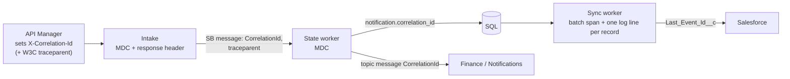

# Operations: Premium Payment Notifications

Scope: the design in [`SOLUTION_DESIGN.md`](../design/SOLUTION_DESIGN.md). Alerts are defined as code in [`infra/modules/alerts.bicep`](../../infra/modules/alerts.bicep).

## 1. SLIs and SLOs (per country: MX, CO, CL)

Measured per country over a rolling 28-day window (Chile has low volume, so shorter windows are noisy).

| # | SLI (good events / valid events) | SLO | Source | From |
|---|---|---|---|---|
| S1 | **Freshness 5 min:** payments confirmed in Salesforce within 5 min of Intake accepting the notification / payments recorded | **95%** or more | `PaymentRecorded` event: `freshnessSeconds = recorded_at - received_at` | NFR2 |
| S2 | **Freshness 1 h:** same, within 60 min | **99.5%** or more | same | NFR2 |
| S3 | **No loss:** accepted notifications (`2xx`) that reach a final status within 24 h (recorded, duplicate, superseded, or parked with an open ops item) / accepted notifications | **100%**. Any miss is an incident | Daily reconciliation: Intake accepted count vs `notification` table vs Salesforce (`Payment_Key__c`) | NFR3 |
| S4 | **Intake availability:** authentic webhooks answered `2xx` in under 2 s / authentic webhooks | **99.9%** or more | API Manager and Intake telemetry | NFR3, NFR4 |
| S5 | **Data-quality backlog:** `FAILED` or parked payments older than 4 business hours | **0** | Ops API | FR7 |

Notes:
- Provider time is approximated by Intake's `received_at`. Delays before delivery cannot be measured.
- S1 and S2 are also shown excluding Salesforce outages, because 97% Salesforce availability alone can use the S2 budget (design section 6, A-10). The SLO is the overall number.

## 2. Instrumentation

### How the correlation id travels

- The API Manager creates the id or keeps a valid incoming one. Intake replaces unsafe values (tested).
- Intake writes it to the Service Bus `CorrelationId` and to the event body. OpenTelemetry (Application Insights Java agent) carries `traceparent` through Service Bus, so one notification is one trace.
- The Sync worker's batch span links to every record's trace and logs one line per record with its `correlationId`. Salesforce stores `Last_Event_Id__c`, which our store maps back to the correlation id. Any Salesforce record can be traced back to its HTTP request.

### What we log, trace and measure

| Kind | Content |
|---|---|
| **Logs** (JSON, Log Analytics) | `timestamp, level, service, correlationId, country, provider, idempotencyKey, providerEventId, providerTransactionId, paymentKey, status, outcome, errorCode, latencyMs`. One line per decision: accepted, duplicate, ignored, rejected, applied, superseded, recorded, failed, dead-lettered. |
| **Traces** | HTTP request, Service Bus send, State worker, SQL, topic publish. Sync batches with links. |
| **Metrics** (by `country` and `provider`) | `payments_intake_accepted`, `payments_intake_rejected{reason}`, `payments_duplicates`, `payments_superseded`, `payments_unresolved_policy`, `payments_dlq_depth`, `payments_sync_pending`, `payments_sync_oldest_pending_seconds`, `payments_sf_calls{status}`, `payments_sf_api_budget_used_ratio`. Events `PaymentRecorded{freshnessSeconds}` and `PaymentSyncFailed{errorCode}` (not sampled: they feed S1 to S3). |

### What we must never log

- Payer **name, national ID (CC, RUT), email**, or any field of `pagador`, `payer` or `customer` (NFR6).
- **Raw request bodies** and full header dumps. Only the SHA-256 of the body is stored.
- **Payment tokens**, webhook **signatures**, **secrets**, Salesforce **access tokens**, `Authorization` headers.
- Free text typed by the payer (for example Andina's raw `referencia`) goes to the access-controlled store, not to logs.

Enforced by the Part B tests `personalDataIsNeverLogged` and `eventContainsNoPersonalData`. Next step: a Log Analytics ingestion-time transformation that drops fields like `email|documento|rut|nombre` (not in the IaC yet).

## 3. Alerts

All alerts are in `alerts.bicep`, enabled in test and prod. Per-country alerts are generated from the `providers` list, so a new country gets them automatically. This closes the INC-0412 gap, where only the pilot country had a DLQ alert.

| Alert | Threshold | Severity | Who |
|---|---|---|---|
| DLQ not empty (queue or any topic subscription) | > 0 in 5 min | **Sev 1** | **Page** on-call |
| DLQ per country | > 0 in 15 min | **Sev 1** | **Page** on-call |
| Queue backlog | > 5,000 for 15 min | Sev 2 | **Page** on-call |
| Freshness p95, per country | > 5 min over 30 min | Sev 2 | **Page** on-call |
| Salesforce permanent rejections (`400`), per country | > 5 in 15 min | Sev 2 | On-call + Salesforce team |
| No traffic, per country | 0 accepted in 60 min | Sev 2 | **Page** on-call (provider outage, routing or secret problem). May fire on quiet nights; tune per country |
| Salesforce API budget, 24 h | > 50% | Sev 2 | On-call |
| Salesforce API budget, 24 h | > 80% | **Sev 1** | **Page** on-call + Salesforce team (shared org limit) |
| Invalid signatures, per country | > 20 in 15 min | Sev 3 | Ticket to the squad |
| Unresolved policy references, per country | > 10 in 1 h | Sev 3 | Ticket to operations |

Rules:
- Each alert needs a runbook (next step): DLQ triage and replay, resync of `FAILED` rows, API budget protection, secret rotation.
- Paging uses the existing platform action group (A-19). Secondary: squad lead. The Salesforce team and the contact center are informed for customer-impacting incidents.
- Today every alert reaches that action group. Sending Sev 3 to a ticket instead of a page (alert processing rule) is a next step.